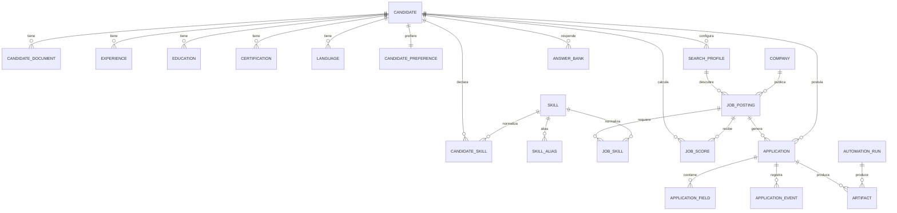

# Modelo de datos

## Convenciones

- SQLite en WAL, `foreign_keys=ON`, `busy_timeout`.
- Tablas plurales `snake_case`.
- PK `TEXT` de 26 caracteres tipo ULID.
- Fechas UTC con `timezone=True`.
- JSON solo para datos flexibles (componentes, evidencias, respuestas crudas).
- Catálogos normalizados para skills y alias.
- Sin cookies, tokens ni contraseñas.

## Diagrama



## Tablas

### Perfil

- `candidate`: identidad, headline, resumen, años, inglés.
- `candidate_document`: PDF original, hash, ruta, texto, principal.
- `candidate_preference`: títulos objetivo, ubicaciones, modalidades, exclusiones.
- `experience`, `education`, `certification`, `language`.
- `skill`, `skill_alias`, `candidate_skill`.

### Descubrimiento

- `search_profile`: palabras clave, filtros, umbral, frecuencia.
- `company`: nombre normalizado.
- `job_posting`: oferta normalizada y respuesta cruda.
- `job_skill`: skill requerida/deseable con evidencia.

### Scoring

- `job_score`: total, banda, componentes, coincidencias, faltantes, riesgos, versión.

### Postulación

- `application`: estado, score, CV usado, confirmación, error.
- `application_field`: campo, valor, fuente, confianza, requerido, paso.
- `application_event`: auditoría legible.
- `artifact`: capturas y archivos de evidencia.

### Operación

- `automation_run`: cola y resultado.
- `audit_log`: acciones del sistema.
- `setting`: configuración persistente futura.

## Por qué JSON

`components`, `matched_skills`, `risks` y `raw_payload` cambian con la versión de la rúbrica o del MCP. Se guardan como JSON versionado. Las relaciones consultables (skills, ofertas, postulaciones) están normalizadas.

## Migraciones

```bash
make migrate
make seed
```

Alembic es la fuente de verdad del esquema. `init_db()` solo crea tablas faltantes para desarrollo y tests.
